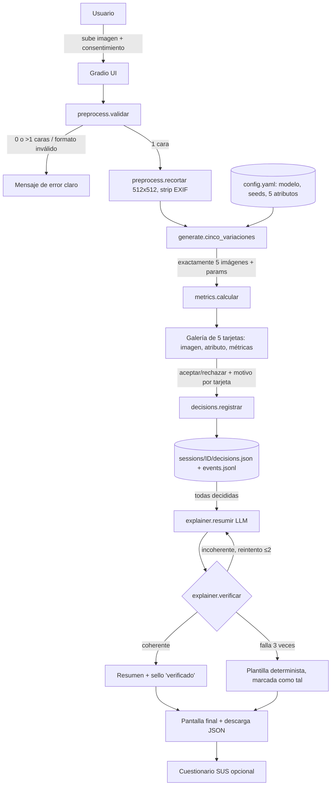

# 06 — Arquitectura propuesta

Decisiones de entrada:
- Colab T4 como entorno principal.
- LLM local pequeño para el agente.
- Dominio de rostros.
- Método generativo **provisional**: A3 (img2img + ControlNet) con caída a A2. Se confirma tras el piloto (04).

## 1. Flujo



## 2. Módulos e interfaces

| Módulo | Responsabilidad | Interfaz principal |
|---|---|---|
| `app/preprocess.py` | Validar tipo y tamaño (≤10 MB, PNG/JPG/WebP), detectar caras (MTCNN de facenet-pytorch), recortar y redimensionar a 512², eliminar EXIF | `validar(img) -> Resultado(ok, motivo)`; `preparar(img) -> PIL.Image` |
| `app/generate.py` | Cargar el pipeline una vez y producir 5 variaciones con sus atributos | `cinco_variaciones(img, cfg) -> list[Variacion]`, con `assert len == 5` |
| `app/metrics.py` | Identidad (FaceNet), LPIPS, CLIPScore del atributo, diversidad del set, flags de fallo | `por_imagen(orig, var) -> dict`; `del_set(vars) -> dict` |
| `app/decisions.py` | Esquema pydantic y persistencia | `Sesion`, `Decision`; `registrar(sesion_id, var_id, decision, motivo)`; `exportar(sesion_id) -> dict` |
| `app/explainer.py` | Prompt (CONTEXTO/TAREA/RESTRICCIONES/FORMATO, Sem10 p60–61), llamada al LLM y verificación | `resumir(sesion: dict) -> Resumen`; `verificar(resumen, sesion) -> list[Error]` |
| `app/ui.py` | Interfaz Gradio (Blocks), estado por sesión | `build() -> gr.Blocks` |
| `app/config.yaml` | Modelo y revisiones, scheduler, pasos, strength, los 5 atributos (prompt + seed), umbrales | — |
| `run_colab.ipynb` | Notebook de arranque reproducible: instalar con versiones fijadas → descargar pesos → `ui.build().launch(share=True)` | — |
| `experimentos/` | Scripts del piloto y la campaña, evaluación ciega, análisis | — |
| `tests/` | Tests de esquema, verificador y "exactamente 5" (con un generador simulado, sin GPU) | — |

### Esquema de decisión (`decisions.json`)
```json
{
  "session_id": "2026-10-21T15-02-11_ab12",
  "input": {"sha256": "…", "width": 512, "height": 512, "consent": true},
  "generator": {"method": "A3", "model": "…@rev", "controlnet": "…@rev", "steps": 25, "cfg": 7.0},
  "variations": [
    {"id": "V1", "attribute": "iluminación cálida", "prompt": "…", "seed": 1001, "strength": 0.65,
     "metrics": {"identity": 0.71, "lpips": 0.32, "clip_delta": 0.04},
     "decision": "aceptada", "reason": "conserva la cara", "decided_at": "…"}
  ],
  "summary": {"text": "…", "llm": "Qwen2.5-3B-Instruct@rev", "verified": true, "attempts": 1, "fallback": false}
}
```
Cada clic también se añade a `events.jsonl` (append-only). Así queda trazado si el usuario cambia de opinión, cosa que el notebook no permitía reconstruir.

### Agente explicador
- **Entrada**: solo `variations[].{id, attribute, decision, reason, metrics}`. Nunca la conversación libre.
- **Salida forzada (JSON)**: `{"aceptadas":["V1","V4"],"rechazadas":["V2","V3","V5"],"resumen":"…"}`.
- **Verificador determinista**:
  1. Los conjuntos `aceptadas`/`rechazadas` coinciden exactamente con el registro.
  2. Su unión es {V1…V5} y son disjuntos.
  3. Cada ID aparece en `resumen`, y en su frase no aparece el estado contrario.
  4. No aparecen IDs inexistentes.
  5. Si hay motivo, se menciona al menos un término de él (si falla es solo un aviso, no un error).
- **Modelo**: Qwen2.5-3B-Instruct en T4 fp16 (~7 GB [E]) o 1.5B si la VRAM no da junto a SD. Decodificación greedy (`do_sample=False`) para que sea reproducible.
- **Casos borde** cubiertos por tests: 5/5 aceptadas, 0/5 aceptadas, motivos vacíos y motivos con texto que intenta "inyectar" instrucciones (se tratan como datos entre delimitadores).

## 3. Tecnologías
| Capa | Elección | Justificación |
|---|---|---|
| Generación | `diffusers` (SD 1.5 + ControlNet SD 1.5), Euler, fp16 | Medido en el notebook; ComfyUI descartado (02 §7) |
| Métricas | `facenet-pytorch` (MIT), `lpips`, CLIP ViT-B/32 vía `transformers`, `scikit-image` (SSIM) | Gratuitas y locales; CLIP tiene base en el curso (Session7.0 p58) |
| LLM | `transformers` + Qwen2.5-Instruct (Apache-2.0) | Local, gratis, reproducible; el usuario eligió LLM local |
| UI | Gradio (Blocks, `gr.State`, `share=True` en Colab) | Funciona en Colab y en local (ya instalado: 6.15.2) |
| Datos | pydantic + JSON/JSONL | Estructurado y validable |
| Tests | pytest | Verificador y esquema sin GPU |

## 4. Ética integrada en el diseño
- **Consentimiento** obligatorio (casilla) antes de subir. Aviso de no subir fotos de terceros.
- Por defecto **no se guardan las caras subidas** fuera de la sesión: solo el hash y las métricas. Guardarlas exige un opt-in explícito (necesario para el informe con imágenes propias o sintéticas).
- Etiqueta visible "Imagen generada por IA" en cada variación y en las descargas, más metadatos PNG.
- Safety checker de SD activo. Se registra su tasa de activación (falsos positivos con caras).
- Atributos **prohibidos** en `config.yaml`: no se ofrecen variaciones que cambien raza/etnia, edad drástica ni género. Evita la manipulación de identidad y el refuerzo de estereotipos (Sem9 p71, p81).
- EDA de sesgo: se informa del rendimiento (identidad y tasa de fallos) desglosado por grupo aparente en las imágenes de prueba, sin afirmar equidad formal si la muestra no lo permite (criterio tomado de `main (3).pdf` p4).

## 5. Evaluación del sistema (rúbrica §2.6)
| Dimensión | Métrica |
|---|---|
| Calidad visual | Tasa de fallos duros, calificación humana 1–5, identidad media |
| Diversidad | LPIPS y distancia CLIP por pares en el set |
| Explicabilidad/coherencia | % de resúmenes que pasan el verificador al primer intento; % de fallback; revisión humana de 20 resúmenes (fiel / claro, 1–5) |
| Usabilidad | SUS (10 ítems) con ≥5 usuarios, tiempo hasta completar las 5 decisiones, errores de uso |
| Coste | Segundos por sesión y VRAM pico |


---

## Revisión 2 (2026-10-21)
Texto original conservado arriba. Detalle y fuentes en `10_verificaciones_y_plan_piloto.md`.
- El código va en el paquete `p2/` (config, env_check, preprocess, generate, metrics, schemas, decisions, verifier, explainer, ui, export), más `experiments/pilot.py` y `experiments/blind_eval.py`.
- Backends del generador: `mock` (local, transformaciones PIL deterministas, que además sirven de línea base clásica) y `sd15_img2img` (Colab).
- Ubicación de ejecución: generación y métricas en Colab; registro, verificador, UI con mock, evaluación ciega y análisis en Windows.
- Explicador: interfaz `llm: str -> str` con stub en los tests y respaldo por plantilla marcado; el LLM real llegará en una etapa posterior.
- Detección de caras con OpenCV Haar (sin descarga) en lugar de MTCNN.
- Dependencias: no se cambia ningún paquete preinstalado. `p2/env_check.compat_plan` y el análisis de `pip --dry-run --report` bloquean cualquier subida o bajada de versión.
