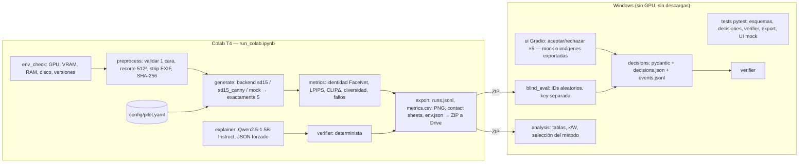

# 09 — Arquitectura de ejecución y preparación del piloto (propuesta, pendiente de aprobación)

Fecha: 2026-10-21. Este documento es **nuevo**: no modifica los 01–08 y propone los cambios para ellos en la §9.

Marcas: **[M]** medido o verificado hoy · **[E]** estimación · **[H]** hipótesis.

En esta fase no se descargó, instaló, ejecutó ni generó nada. Las únicas consultas fueron de metadatos públicos (PyPI, Hugging Face y Kaggle) y la lista de paquetes locales.

---

## 1. Dataset propuesto: SFHQ parte 3 (rostros sintéticos)

| Campo | Valor | Verificación |
|---|---|---|
| Nombre | Synthetic Faces High Quality (SFHQ) — **part 3** | [M] |
| Autor | David Beniaguev | [M] |
| Fuente oficial | Kaggle: https://www.kaggle.com/datasets/selfishgene/synthetic-faces-high-quality-sfhq-part-3 · Repo: https://github.com/SelfishGene/SFHQ-dataset | [M] |
| **Licencia de los datos** | **CC0: Public Domain**. Es el campo `licenseName` del dataset en la API pública de Kaggle (`/api/v1/datasets/view/selfishgene/synthetic-faces-high-quality-sfhq-part-3`), consultado el 2026-10-21. Las partes 1, 2 y 4 también figuran como CC0 | [M] |
| Licencia del repositorio GitHub | MIT (Copyright 2022 David Beniaguev). Cubre el **código** de ejemplo, no las imágenes | [M] |
| Contenido | 118,358 imágenes de 1024×1024 generadas con StyleGAN2 (truncation psi alta corregida con e4e), más landmarks y segmentación facial | [M] |
| Tamaño total | 23.0 GB | [M] (API Kaggle) |
| **Subconjunto oficial pequeño** | Carpeta `a small samples (750 images)/` dentro del propio dataset (p.ej. `SFHQ_pt3_00000010.jpg`, 153,796 bytes) → ~110 MB en total | [M] lista de archivos; [E] tamaño total |
| Última versión | v4, 2022-12-18 | [M] |

### Por qué la parte 3 y no otra
- Las partes 1 y 2 parten de obras de terceros: AAHQ (ArtStation), Close-Up Humans y Face Synthetics. Eso añade derechos de autor de las obras de origen.
- La parte 4 parte de muestras de SD 2.1.
- La parte 3 parte **solo de muestras del propio StyleGAN2**: es la procedencia más limpia.
- **FFHQ se descarta**: son personas reales de Flickr. Su licencia es CC BY-NC-SA 4.0 con licencias por imagen y atribución por imagen, exige compartir derivados bajo la misma licencia, y NVIDIA pide no usarla para reconocimiento facial. Además existe un mecanismo de exclusión (opt-out) de personas reales, lo que implica un riesgo de privacidad.
- **CelebA se descarta**: personas reales (celebridades) y uso solo no comercial.

### Condiciones relevantes y límites (honestos)
- **Uso académico y transformaciones**: CC0 renuncia a todos los derechos; permite usar, modificar y redistribuir sin atribución obligatoria. Aun así se citará la fuente como buena práctica.
- **Redistribución**: permitida. Las imágenes elegidas pueden guardarse en el repositorio del proyecto con un manifiesto SHA-256. Así Colab no necesita credenciales de Kaggle.
- **Acceso**: Kaggle exige iniciar sesión para descargar, y eso implica aceptar sus Términos de Servicio. CC0 es la licencia de los datos; los ToS rigen el acceso a la plataforma. Son dos cosas distintas.
- **Privacidad**: el autor declara que "no hay problemas de privacidad ni de licencia" porque son caras sintéticas. Nos apoyamos en esa declaración, con estos límites:
  - [H] StyleGAN2 se entrenó con FFHQ (fotos reales). No se puede descartar que alguna cara generada **se parezca** a una persona real; el riesgo se considera bajo pero no nulo. Se documentará como limitación ética.
  - Los pesos de StyleGAN2 de NVIDIA tienen licencia no comercial. Afecta al generador, no a nuestro uso de las imágenes ya publicadas como CC0, y nuestro uso es académico. Lo menciona el informe.
- **Sesgos**: el autor reconoce que "hereda todos los sesgos de sus datasets originales" (FFHQ). Además faltan accesorios y oclusiones (sombreros, auriculares). El EDA deberá reportar la distribución aparente de edad, tono de piel y género, sin afirmar equidad formal.
- **Mirror no oficial** en Hugging Face (`pravsels/SFHQ`): **no se usa**, porque es una resubida de terceros con procedencia no verificable.

### Uso previsto (tras aprobación)
1. El usuario descarga manualmente desde la web de Kaggle (sesión propia) **30 imágenes** de `a small samples (750 images)/`: 3 para el piloto y 27 para el EDA. Son ~5 MB. Se eligen con una regla fija: barajado con semilla 2026 de la lista de 750 y revisión visual para cubrir variedad aparente (edad, tono de piel, género, pose). La selección y su motivo se registran.
2. Se guardan en `data/sfhq_pt3/` con un `MANIFEST.csv` (nombre, SHA-256, fuente, licencia).

**Pendiente de aprobación explícita: no se ha descargado nada.**

### 1.b Revisión (2026-10-21): dataset preferido por el usuario → SFHQ-T2I
El usuario prefiere **SFHQ-T2I** y deja **SFHQ parte 3** (arriba) como alternativa. También indica que bastan **pocas imágenes**.

| Campo | Valor | Verificación |
|---|---|---|
| Nombre | Synthetic Faces High Quality – Text 2 Image (SFHQ-T2I) | [M] |
| Fuente oficial | Kaggle: https://www.kaggle.com/datasets/selfishgene/sfhq-t2i-synthetic-faces-from-text-2-image-models · Repo: https://github.com/SelfishGene/SFHQ-T2I-dataset | [M] |
| **Licencia de los datos** | **MIT**: es el campo `licenseName` de la API pública de Kaggle, consultada el 2026-10-21. El repositorio tiene `LICENSE.txt` MIT, "Copyright (c) 2024 David Beniaguev". La descripción añade: "The dataset is free for anyone to use as they please" | [M] |
| Contenido | 122,726 imágenes de 1024×1024 generadas por Flux1.pro, Flux1.dev, Flux1.schnell, SDXL y DALL-E 3 a partir de prompts aleatorios, con curación semimanual. El CSV `SFHQ_T2I_dataset.csv` (59.5 MB) trae el prompt, el modelo y la semilla de cada imagen | [M] |
| Tamaño total | 24.5 GB (versión 1, 2024-10-04) | [M] |
| **Muestra oficial** | `a_small_sample_new/`: en las primeras 2,000 entradas listadas hay 992 FLUX1_dev (173.5 MB), 378 FLUX1_pro, 619 SDXL (106.8 MB) y 10 DALLE3 (~150–220 KB por imagen). El listado público se corta en 2,000 archivos, así que puede haber más | [M] |

**Condiciones relevantes:**
- **MIT**: permite usar, copiar, modificar y redistribuir. Una condición: al redistribuir copias hay que **incluir el aviso de copyright y el texto de la licencia**. Por eso `data/sfhq_t2i/` llevará `LICENSE_MIT.txt` con el aviso de David Beniaguev.
  - MIT es una licencia pensada para software y aplicada aquí a imágenes. Es inusual, pero sus términos son permisivos y claros.
- **Condiciones heredadas de cada generador** (afectan a las salidas, no a nuestro uso académico):
  - **FLUX.1 [dev]**, Non-Commercial License v1.1.1: "We claim no ownership rights in and to the Outputs"; "You may use Output for any purpose (including for commercial purposes), except as expressly prohibited". Prohibido usar las salidas para entrenar un modelo competidor de FLUX y hay que revisar el contenido antes de difundirlo [M, licencia en HF].
  - **SDXL**: CreativeML OpenRAIL++-M, con restricciones de uso y sin reclamar las salidas [E, no verificado hoy].
  - **Flux1.pro y DALL-E 3**: términos de API de sus proveedores [E].
- **Decisión propuesta**: usar solo imágenes **SDXL y FLUX1_dev**, cuyas condiciones sobre salidas son claras, y evitar DALL-E 3 y Flux1.pro. No entrenamos ningún modelo con ellas, así que la restricción de FLUX no aplica.
- **Privacidad**: son caras sintéticas generadas desde texto, no desde fotos de personas. El riesgo de parecido con una persona real es [H] bajo pero no nulo, igual que en la parte 3. Se declara como limitación.
- **Ventaja frente a la parte 3**: los prompts controlan explícitamente etnia, edad, pose, accesorios y fondo, así que hay más diversidad demográfica. Facilita el análisis de sesgo (§2.7) y el CSV da etiquetas de atributos en lugar de estimarlas "a ojo".
  - [H] Riesgo: algunas imágenes son menos "fotográficas" (estilizadas o con oclusiones). Se filtran en la selección.
- **Acceso**: igual que antes, la descarga desde Kaggle exige sesión (sus ToS). Kaggle permite descargar archivos sueltos desde la web.

**Cantidad revisada ("con algunas está bien")**: **10 imágenes** de `a_small_sample_new/` (~2 MB).
- 3 para el piloto (I1–I3).
- 7 para el mini-EDA y la demo. También sirven para calibrar de forma orientativa el umbral de identidad. Con pocas imágenes la calibración queda débil y se reportará así.
- Criterios de selección:
  - Solo SDXL y FLUX1_dev.
  - Rostro único, frontal o en 3/4, fotorrealista y sin oclusión fuerte.
  - Variedad aparente de edad, tono de piel y género.
  - Se registran el nombre y SHA-256 de cada archivo y el motivo de su elección.
- El CSV de 59.5 MB es **opcional**: solo se necesitaría para leer los prompts de esas 10 imágenes.

Estado: **pendiente de aprobación explícita; no se ha descargado nada.**

---

## 2. Comparación de arquitecturas de ejecución

Datos de partida:
- Local [M]: RTX 3050 Laptop de 4 GB, driver 577 / CUDA 12.9, 15.7 GB de RAM, 22 GB libres en C: (95 % lleno). Python 3.14 con pydantic 2.13, pytest 9.1, gradio 6.15.2, Pillow 12.2, numpy 2.4, jsonschema, PyYAML y pandas, **sin torch**.
- Colab [M en `Untitled1.ipynb`]: T4 de 14.56 GB y ~13.6 GB de RAM.

| Criterio | A. Todo en Windows | B. Dev/tests en Windows + generación en Colab | C. Híbrido (perfil local o Colab) |
|---|---|---|---|
| Instalación | torch CUDA (~2.5–3.5 GB [E]) + diffusers, transformers, lpips… en un venv; posibles fricciones de Windows (rutas largas, compiladores) | Local: **nada que instalar** para los tests (ya está todo [M]). Colab: solo 3 paquetes extra | Igual que B + un venv local opcional con torch |
| VRAM | SD1.5 fp16 ≈ 2.2 GB de pesos [M sizes] + activaciones → cabe justo sin ControlNet [E]. Con ControlNet (+0.72 GB) se pasa de 4 GB → offload. SD y LLM a la vez: no caben | T4 de 14.5 GB: SD + ControlNet + métricas holgado; el LLM de 1.5B (3.1 GB) también, liberando SD antes por prudencia | Local solo SD sin ControlNet o con offload; el resto en Colab |
| RAM | 15.7 GB: suficiente | Colab ~12.7–13.6 GB: suficiente cargando por fases | — |
| Almacenamiento | ~3 GB de torch + ~7.5 GB de pesos + caché → **~11–13 GB de 22 libres** [E]; deja el disco al ~98 % | Local: solo resultados (~50 MB). Colab: ~8 GB efímeros | A + B |
| Velocidad | [E] SD1.5 512² en una 3050 Laptop: ~3–5 it/s → ~3–6 s por img2img (strength 0.5, 25 pasos → 13 efectivos). Con `model_cpu_offload` ~1.3–2× más lento; con `sequential_cpu_offload` ~5–10× | [E] T4: ~2–8 s/img (medido 5 s con offload a 672×448, celdas 36/44) | Según perfil |
| Coste | 0 € | 0 € (Colab gratis; cuota de GPU variable) | 0 € |
| Reproducibilidad | Buena en una máquina; difícil para el resto del equipo | **Alta**: notebook único, versiones registradas y el mismo hardware que el notebook previo | Media: dos perfiles dan resultados numéricamente distintos (distinta GPU y RNG) |
| Depuración | Cómoda (IDE) para la lógica; lenta para la GPU | Lógica en el IDE con tests y mocks; GPU en Colab | Igual que B |
| Mantenimiento | Un entorno pesado | Dos entornos ligeros | Tres configuraciones que mantener |

### Cuándo haría falta offload en la 3050 (4 GB)
- **SD1.5 img2img sin ControlNet a 512²**: [E] cabe en fp16 con SDPA y `enable_vae_slicing`, sin offload. Sin margen para métricas en GPU a la vez.
- **SD1.5 + ControlNet**: necesita `enable_model_cpu_offload()`, que mueve cada componente a la GPU solo cuando se usa (~1.3–2× más lento [E]).
- **No razonable**:
  - `enable_sequential_cpu_offload` como modo normal: 5–10× más lento, minutos por set.
  - SDXL: pesos fp16 de ~5 GB de UNet; no cabe ni con offload de forma usable.
  - SD + LLM de 1.5B a la vez.
  - Resoluciones > 640².
  - Batch > 1.
  - Ejecutar Qwen2.5-3B.

### Recomendación: **B**, con el código preparado para C sin trabajo extra
- La generación del piloto y de la evaluación se hace en Colab T4.
- Todo lo demás se desarrolla y prueba en Windows sin GPU: registro, verificador, UI con mock, análisis y evaluación ciega sobre las imágenes exportadas.
- El módulo generador acepta `device_profile: t4 | local_4gb | mock` en la configuración. El perfil `local_4gb` (con `model_cpu_offload`) queda documentado como opcional y **fuera del piloto**. Así C es un cambio de configuración, no una arquitectura nueva.

---

## 3. Arquitectura recomendada



| Módulo | Responsabilidad | Se ejecuta en | Dependencias pesadas |
|---|---|---|---|
| `env_check` | Detectar GPU, VRAM, RAM, disco y versiones; abortar con mensaje explicativo | Colab | torch (preinstalado) |
| `preprocess` | Validar formato y tamaño, detectar exactamente 1 cara (MTCNN), recortar y redimensionar a 512², eliminar EXIF, calcular el hash | Colab (local: validación sin detector) | facenet-pytorch |
| `generate` | Interfaz `cinco_variaciones(img, cfg) -> list[Variation]` con `len == 5` garantizado. Backends: `sd15_img2img`, `sd15_canny`, `mock` (transformaciones PIL deterministas, que además sirven como línea base A0) | Colab / mock local | diffusers |
| `metrics` | Por imagen y por set; banderas de fallo duro | Colab | lpips, transformers (CLIP), facenet |
| `decisions` | Esquemas pydantic `Session`, `Variation`, `Decision`; persistencia atómica (escritura temporal + rename); historial append-only | Ambos | — |
| `ui` | Gradio: 5 tarjetas con aceptar/rechazar y motivo; botón de resumen deshabilitado hasta 5/5 | Ambos | gradio |
| `explainer` | Prompt CONTEXTO/TAREA/RESTRICCIONES/FORMATO (Sem10 p60–61); salida JSON; reintentos ≤2; fallback de plantilla marcado | Colab (local: stub) | transformers |
| `verifier` | Comparación de conjuntos de IDs, estados por frase, IDs inventados; devuelve una lista de errores | Ambos | — (stdlib) |
| `export` | Empaquetar imágenes, métricas, configuración, decisiones y `env.json` con versiones y hashes | Ambos | — |
| `blind_eval` / `analysis` | Evaluación ciega y selección del método (doc 04 §8) | Windows | gradio, pandas |

---

## 4. Diseño del piloto comparativo

### Métodos (3) y justificación
| ID | Método | Por qué |
|---|---|---|
| **A1 (línea base)** | SD1.5 img2img + Euler, **un prompt genérico**, 5 semillas, strength 0.40. Es la configuración de la celda 44 de `Untitled1.ipynb` | Es lo que ya existe y su defecto está medido: las 5 salen casi idénticas. Se **repite en rostros** porque ningún experimento previo usó caras |
| **A2 (ablación)** | SD1.5 img2img + Euler, **5 prompts de atributo** (doc 04 §3), strength ∈ {0.40, 0.50, 0.60} en I1 → se fija el mejor | Aísla el efecto de condicionar por atributo. Cero descargas extra |
| **A3 (alternativa)** | A2 + **ControlNet canny SD1.5** (`lllyasviel/control_v11p_sd15_canny`), strength ∈ {0.55, 0.65, 0.75}, `controlnet_conditioning_scale` 0.8 | Es el condicionamiento que nombra el enunciado (§2.3). Debería permitir más cambio de estilo conservando contorno y pose. Se elige **canny** en vez de softedge porque el mapa sale de OpenCV (preinstalado): no hace falta `controlnet_aux` ni pesos de anotador |

No se repiten del notebook (no aportan): ComfyUI, el scheduler PNDM y la entrada a 512×341.

A0 (clásico) se obtiene gratis con el backend `mock` y se incluye en las hojas de contacto como referencia, sin coste de GPU.

### Modelos
| Rol | Modelo | Revisión (HF `sha`, 2026-10-21) | Licencia | Descarga [M tamaños HF] |
|---|---|---|---|---|
| Generador | `stable-diffusion-v1-5/stable-diffusion-v1-5`, `variant="fp16"` | `451f4fe161…` | CreativeML OpenRAIL-M (restricciones de uso; permite investigación) | UNet 1.72 + text encoder 0.25 + VAE 0.17 + safety checker 0.61 + tokenizer/configs ≈ **2.75 GB** |
| Control | `lllyasviel/control_v11p_sd15_canny` fp16 | `115a470d54…` | OpenRAIL | **0.72 GB** |
| Explicador | `Qwen/Qwen2.5-1.5B-Instruct` (fp16 en T4) | `989aa7980e…` | **Apache-2.0** | **3.09 GB** |
| CLIP (métrica) | `openai/clip-vit-base-patch32` | `3d74acf9a2…` | MIT [E] (sin campo en la ficha) | **0.61 GB** (solo `pytorch_model.bin`) |
| LPIPS | `lpips` (AlexNet + capa lineal) | paquete 0.1.4 | BSD-2 [E] | ~0.25 GB (pesos torchvision AlexNet) [E] |
| Identidad | FaceNet `vggface2` (facenet-pytorch) + MTCNN | paquete 2.6.0 | MIT [E] | ~0.11 GB [E] |

Se **descarta Qwen2.5-3B-Instruct** en esta fase: su ficha indica licencia "other" (no Apache) y pesa 6.2 GB [M].

El notebook previo descargó los pesos fp32 (`v1-5-pruned-emaonly`, 3.97–4.27 GB). Con `variant="fp16"` se ahorra ~1.5 GB.

### Dependencias y versiones (Colab)
Principio: **no tocar torch, torchvision, numpy ni Pillow de Colab** (la celda 3 del notebook rompió torchvision al hacerlo). Se registran en `env.json`.

| Paquete | Acción | Motivo |
|---|---|---|
| torch / torchvision / numpy / Pillow / opencv / scikit-image / pydantic / pandas / PyYAML | **Preinstalados**: solo verificar que `torch.cuda.is_available()` y que la versión de torch es ≥ 2.4 | Evitar conflictos |
| `diffusers==0.40.0` | Instalar | Es la versión **medida y funcional** en el notebook previo (la última es 0.41.0, no probada) |
| `transformers`, `accelerate` | Usar la versión preinstalada si cumple `transformers>=4.45` (Qwen2.5 y CLIP) y `accelerate>=0.30`; si no, abortar con un mensaje | No forzar actualizaciones |
| `lpips==0.1.4` | Instalar | Solo depende de torch y torchvision, que ya están |
| `facenet-pytorch==2.6.0` | Instalar **con `--no-deps`** | Su metadato exige `torch<2.3`, `numpy<2` y `Pillow<10.3` [M PyPI]: una instalación normal **degradaría torch**. Con `--no-deps` se prueba en una celda smoke test; si falla, se usa el plan B: similitud de embedding DINOv2/CLIP del recorte facial, marcada como "proxy de identidad" |
| `gradio` | **No se instala en Colab para el piloto** | La evaluación ciega se hace en Windows (gradio 6.15.2 ya instalado) |

Después de instalar se ejecuta `pip freeze > env/pip_freeze.txt`, que se exporta junto a los resultados.

### Imágenes y generaciones
| Bloque | Cálculo | Generaciones |
|---|---|---|
| Calentamiento (descartado) | 1 por pipeline × 2 | 2 |
| Barrido de strength en I1 | (A2: 3 + A3: 3) × 5 variaciones | 30 |
| Piloto principal | 3 imágenes × 3 métodos × 5 variaciones (A2 y A3 con su strength ya fijado; A1 fijo en 0.40) | 45 |
| **Total** | | **77 imágenes** (~35 MB en PNG 512² [E]) |
| Explicador | 20 sesiones de decisiones **simuladas** (incluye 0/5, 5/5, motivos vacíos y un motivo con texto que intenta inyectar instrucciones) × 1 | 20 resúmenes |

### Semillas y parámetros fijos
- Imagen 512×512, fp16, `EulerDiscreteScheduler`, 25 pasos, cfg 7.0.
- Negative prompt común (doc 04 §3).
- `torch.Generator("cuda").manual_seed(1000 + k)` con k = 1..5 (variación k). La misma semilla para el mismo k en todos los métodos.
- Safety checker **activo**; se registra si se activa.
- Explicador: `do_sample=False`, `max_new_tokens=300`.
- Selección de las imágenes del dataset: semilla 2026.
- Determinismo: `torch.backends.cudnn.benchmark=False`. Se registran `torch.__version__`, el driver y CUDA.

### Métricas e interpretación
| Métrica | Interpretación | Umbral / uso |
|---|---|---|
| Identidad (coseno FaceNet vs original) | ¿Sigue siendo la misma persona? | Se calibra con pares mismo/distinto de las 27 imágenes de EDA: el umbral es el punto medio entre distribuciones [H]. Por debajo → fallo duro |
| LPIPS(orig, var) | Cuánto cambió perceptualmente | Ni ~0 (no cambió nada) ni muy alto (otra imagen). Se reporta, no se optimiza |
| CLIPΔ = CLIP(var, texto del atributo) − CLIP(orig, mismo texto) | ¿Se aplicó el atributo pedido? | > 0 esperado; para A1 se usa el texto genérico |
| Diversidad: LPIPS medio de los 10 pares y distancia CLIP media | ¿Son 5 alternativas distintas? | A1 debería salir bajo (hipótesis que el piloto confirma o refuta) |
| Fallos | Cara no detectada, NSFW, imagen negra | Tasa por método |
| Coste | s/imagen y VRAM pico | Comparación |
| Explicador | % de sesiones que pasan el verificador al primer intento; % de fallback; latencia | Objetivo ≥ 95 % sobre las 20 simuladas |

La selección del método sigue la regla prerregistrada del doc 04 §8, completada con la evaluación humana ciega en Windows.

### Tiempo estimado (estimación, no medido)
| Fase | [E] |
|---|---|
| Arranque y comprobaciones | 1–2 min |
| Instalación de 3 paquetes | 1–2 min |
| Descargas (~7.5 GB desde HF en Colab) | 4–10 min |
| Generación de 77 imágenes (2–8 s/img) | 4–9 min |
| Métricas | 2–4 min |
| Explicador (20 × ~5–15 s) | 2–5 min |
| Exportación a Drive | 1–2 min |
| **Total** | **~15–35 min** |

### Estimación de recursos
| Recurso | Colab T4 [E] | Windows |
|---|---|---|
| Descargas | SD fp16 2.75 + ControlNet 0.72 + Qwen 3.09 + CLIP 0.61 + AlexNet 0.25 + FaceNet 0.11 + paquetes ~0.1 ≈ **7.6 GB** | Imágenes SFHQ ~5 MB + ZIP de resultados ~40–60 MB |
| Disco | ~8 GB de caché HF + ~0.1 GB de salidas (Colab ofrece ~78–100 GB efímeros [E]) | < 0.1 GB |
| VRAM pico | SD + ControlNet fp16 a 512²: ~4–5.5 GB; métricas ~1.5 GB; Qwen 1.5B fp16: ~3.5–4.5 GB → **se libera SD antes del explicador**; pico esperado < 7 GB | — |
| RAM | ~5–8 GB al cargar los pipelines (la carga fp16 pasa por la CPU) | < 1 GB (tests) |

---

## 5. Procedimiento en Colab (`run_colab.ipynb`, aún no generado)
Secciones previstas del notebook. Cada una es idempotente y falla con un mensaje claro.

0. **Portada**: qué hace, qué descarga (tabla §4), tiempo estimado y licencia.
1. **Comprobación de recursos** (antes de instalar nada):
   - `nvidia-smi`, `torch.cuda.is_available()`, nombre de la GPU, VRAM total y libre, RAM (`psutil`), disco libre (`shutil.disk_usage`), versiones de Python y torch.
   - Errores explicativos:
     - "No hay GPU: Entorno de ejecución → Cambiar tipo → T4".
     - "VRAM < 12 GB: este notebook asume T4; reduzca a perfil local_4gb o aborte".
     - "Disco < 15 GB".
     - "torch < 2.4".
2. **Código del proyecto**: obtenerlo sin rutas de Windows. Opciones (decisión pendiente, §10):
   - (a) `git clone` de un repositorio público.
   - (b) Subir `proyecto2_src.zip` con `files.upload()` o desde Drive.
3. **Instalación mínima**: `pip install diffusers==0.40.0 lpips==0.1.4` y `pip install --no-deps facenet-pytorch==2.6.0`, seguidos de un smoke test de import y `pip freeze`.
4. **Datos**: tomarlos de `data/sfhq_pt3/` del código obtenido y **verificar el SHA-256** de cada imagen contra `MANIFEST.csv`. Si no coincide, se aborta.
5. **Configuración**: cargar `config/pilot.yaml`, mostrarla y guardar su hash.
6. **Descarga de modelos** con revisión fijada (`revision=` con el sha de la §4) y `variant="fp16"`. No requiere `HF_TOKEN` (modelos no gated [M]); si existe un secreto de Colab `HF_TOKEN`, se usa solo para el límite de velocidad. Nunca se escribe en el notebook.
7. **Generación**: calentamiento → barrido → piloto. Cada imagen se escribe en `runs.jsonl` (esquema del doc 04 §5) al momento, para tolerar desconexiones; se reanuda saltando las ya hechas.
8. **Métricas** → `metrics.csv` y `set_metrics.csv`.
9. **Liberar SD** (`del pipe; torch.cuda.empty_cache()`) → **explicador** sobre las 20 sesiones simuladas → `explainer_results.jsonl` con el veredicto del verificador.
10. **Hojas de contacto** (PNG por imagen × método, con IDs).
11. **Exportación**: `pilot_<fecha>_<hash>.zip` con imágenes, jsonl, csv, config, `env.json` y `pip_freeze.txt`.
    - Opción 1: `drive.mount` → `MyDrive/proyecto2/pilot/`.
    - Opción 2: `files.download`.
12. **Resumen final** en pantalla: tablas medidas, avisos y fallos.

---

## 6. Pruebas ligeras en Windows (sin instalar nada)
El intérprete por defecto es `python` 3.14 con los paquetes del sitio de usuario: pydantic 2.13.4, pytest 9.1.1, gradio 6.15.2, Pillow 12.2.0, numpy 2.4.6, jsonschema, PyYAML y pandas [M]. Sin torch ni modelos.

| Prueba | Qué verifica | Cómo, sin modelos |
|---|---|---|
| `test_schemas.py` | `Session`/`Variation`/`Decision` rechazan datos inválidos (6 variaciones, ID duplicado, decisión ≠ aceptada/rechazada, falta `seed`) | pydantic + JSON de ejemplo |
| `test_decisions.py` | Aceptar y rechazar cada una de las 5; cambiar de opinión deja rastro en `events.jsonl` y el estado final en `decisions.json`; el resumen se bloquea con < 5 decididas; escritura atómica | Directorio temporal (`tmp_path`) |
| `test_verifier.py` | Detecta ID intercambiado, omitido o inventado, estado contrario en una frase, conjuntos no disjuntos; acepta los resúmenes correctos; casos 0/5 y 5/5 | Resúmenes escritos a mano (correctos e incorrectos) |
| `test_explainer_stub.py` | El flujo de reintento → fallback funciona; la plantilla determinista siempre pasa el verificador; el motivo con instrucciones inyectadas se trata como dato | LLM simulado (función que devuelve JSON fijo o defectuoso) |
| `test_generate_mock.py` | El backend `mock` devuelve **exactamente 5** imágenes del mismo tamaño, deterministas (mismo hash dos veces) | Transformaciones PIL |
| `test_export.py` | El ZIP contiene todos los archivos esperados; `env.json` y la configuración son válidos; el manifiesto SHA-256 cuadra | `tmp_path` |
| `test_ui_smoke.py` | `build_ui(backend="mock")` construye sin errores; las funciones de callback (aceptar/rechazar/resumir) actualizan el estado | Se llaman los callbacks directamente, sin navegador; además, prueba manual opcional con `python -m app.ui --mock` en el navegador local |

Comando previsto: `python -m pytest tests -m "not gpu"`. Las pruebas que requieren GPU se marcan `@pytest.mark.gpu` y solo corren en Colab.

Configuración local opcional de SD (perfil `local_4gb`, **no se instala ahora**):
- venv dedicado, torch CUDA 12.x (~2.5–3.5 GB), diffusers y pesos fp16 (~3.5 GB).
- `model_cpu_offload` si hay ControlNet.
- Requiere ~8–12 GB de disco de los 22 libres [E].
- Limitaciones: §2.
- Utilidad: demo sin Internet. No es necesaria para cumplir el enunciado.

---

## 7. Estructura de entregables prevista (no creados aún)
```
proyecto-2/
├─ README.md                  # Windows (tests, UI mock, evaluación ciega) y Colab (piloto/demo)
├─ run_colab.ipynb            # §5
├─ config/
│  ├─ pilot.yaml              # modelos+revisiones, scheduler, pasos, cfg, strengths, 5 atributos, semillas, umbrales
│  └─ app.yaml                # configuración de la app final (device_profile, backend)
├─ requirements/
│  ├─ colab.txt               # diffusers==0.40.0, lpips==0.1.4 (+ facenet-pytorch==2.6.0 --no-deps documentado)
│  ├─ local-tests.txt         # pydantic>=2.10, pytest>=8, gradio==6.15.2, pyyaml, pillow, numpy, jsonschema (ya presentes)
│  └─ local-gpu-optional.txt  # perfil local_4gb (documental)
├─ app/ (preprocess, generate, metrics, decisions, ui, explainer, verifier, export)
├─ experiments/ (pilot.py, blind_eval.py, analysis.py)
├─ data/sfhq_pt3/ (30 imágenes + MANIFEST.csv + LICENSE_CC0.txt)
├─ tests/
└─ docs/
   ├─ hardware_y_almacenamiento.md
   ├─ plan_pruebas_locales.md
   └─ exportacion_resultados.md
```
Exportación de resultados: un ZIP por ejecución, nombrado `<tipo>_<fecha>_<hash-config>`, con:
- `images/<input>/<método>/v<k>_s<seed>.png`
- `runs.jsonl`, `metrics.csv`, `set_metrics.csv`, `explainer_results.jsonl`
- `config.yaml`, `env.json`, `pip_freeze.txt`, `MANIFEST.sha256`

Se conserva en Drive y en local en `results/`, ignorado por git si hay repositorio. El repositorio guarda solo los resúmenes en csv/md.

---

## 8. Riesgos y limitaciones
| Riesgo | Mitigación |
|---|---|
| `facenet-pytorch --no-deps` incompatible con el torch de Colab | Smoke test en el paso 3; plan B de proxy de identidad con DINOv2/CLIP, documentado |
| Colab cambia la versión preinstalada de torch o transformers | Verificar los mínimos; registrar `env.json`; diffusers fijado en 0.40.0 |
| La cuota o desconexión de Colab interrumpe el piloto | `runs.jsonl` incremental + reanudación; export parcial |
| El safety checker ennegrece caras (falsos positivos) | Medir la tasa; no desactivarlo; documentarlo |
| SD1.5 deforma la identidad (la incógnita crítica) | Es lo que mide el piloto; plan B: InstructPix2Pix o IP-Adapter (licencias a revisar) |
| Parecido accidental de una cara SFHQ con una persona real | Limitación declarada; no se presenta ninguna imagen como persona real |
| Sesgos heredados de FFHQ | EDA con desglose aparente; sin afirmar equidad |
| El umbral de identidad se calibra con pocas imágenes | Reportar la incertidumbre; usarlo como orientativo |
| Qwen2.5-1.5B produce JSON inválido o resúmenes infieles | Verificador + reintentos + fallback; métrica de tasa |
| ToS de Kaggle para descargar | Descarga manual con cuenta propia; CC0 permite incluir las imágenes en el repo |
| Disco local al 95 % | En el escenario B no se descargan pesos en local |

---

## 9. Cambios previstos en los documentos existentes
Se harán **añadiendo una sección "Revisión 2 (2026-10-21)"** al final de cada documento, sin borrar el contenido original. El historial queda en el propio archivo.

| Doc | ¿Cambia? | Cambio previsto |
|---|---|---|
| 01 materiales | No | — |
| 02 notebook | No | — |
| 03 comparativa | Sí | Licencias verificadas: Qwen2.5-3B "other" → se usa 1.5B (Apache-2.0); SD1.5 OpenRAIL-M; ControlNet canny en vez de softedge (sin anotador); tamaños de pesos fp16 medidos |
| 04 diseño experimental | Sí | Piloto redefinido: A1/A2/A3, SFHQ pt3, 77 generaciones, semillas `1000+k`, explicador sobre 20 sesiones simuladas, evaluación ciega en Windows |
| 05 agentes/plugins | No | — |
| 06 arquitectura | Sí | Ubicación de ejecución por módulo (Colab/Windows), backend `mock`, `device_profile`, facenet `--no-deps` y plan B, Qwen 1.5B |
| 07 implementación | Sí | E1 concretado (SFHQ pt3, descarga manual de 30 imágenes); nueva tarea "repositorio y entrega del código a Colab"; E5 y E6 desarrollables en local desde ya |
| 08 matriz | Sí | R10 → "parcial" (fuente y licencia verificadas, pendiente de descarga); R21 → plan de reproducibilidad definido |

---

## 10. Decisiones pendientes (requieren aprobación explícita)
1. **Dataset** (revisado, §1.b): aprobar **SFHQ-T2I** (MIT), solo imágenes SDXL y FLUX1_dev, y la descarga manual de **10 imágenes** de `a_small_sample_new/`. La alternativa es SFHQ parte 3 (CC0).
2. **Entrega del código a Colab**: (a) repositorio GitHub público (recomendado: la forma más simple de hacer `git clone` sin credenciales) o (b) ZIP subido a Colab o Drive.
3. **Exportación**: Google Drive (persistente; requiere autorizar `drive.mount` en Colab) o solo `files.download`.
4. Aprobar las 3 actualizaciones de paquetes en Colab (diffusers==0.40.0, lpips==0.1.4, facenet-pytorch==2.6.0 `--no-deps`) y las descargas de ~7.6 GB **en Colab**.
5. Aprobar la creación de la estructura de la §7, de los tests locales y de `run_colab.ipynb`. Esto es implementación preparatoria y **no ejecuta el piloto**.
6. Por separado y después: aprobar la **ejecución** del piloto.

---

## 11. Procedimiento paso a paso (cuando se apruebe)
| # | Acción | Quién | Requisitos | ¿Descarga o ejecuta modelos? |
|---|---|---|---|---|
| 1 | Aplicar la "Revisión 2" a 03, 04, 06, 07 y 08 | Claude | Aprobación del punto 5 | No |
| 2 | Crear `config/`, `requirements/`, los esquemas pydantic, el verifier, decisions, export, el backend mock y los tests | Claude | — | No |
| 3 | Ejecutar `python -m pytest tests -m "not gpu"` en Windows y mostrar la salida | Claude | Paquetes ya presentes [M] | No |
| 4 | UI Gradio con backend mock en local (`python -m app.ui --mock`) | Claude + usuario | gradio 6.15.2 [M] | No |
| 5 | Descargar de Kaggle 10 imágenes SFHQ-T2I (SDXL/FLUX1_dev) a `data/sfhq_t2i/` + `LICENSE_MIT.txt` | **Usuario** (cuenta de Kaggle) | Aprobación del punto 1 | Sí (~2 MB, solo datos) |
| 6 | Generar `MANIFEST.csv` (SHA-256) y el EDA ligero (sin GPU: tamaños, brillo, revisión visual) | Claude | Paso 5 | No |
| 7 | Generar `run_colab.ipynb` y `README.md` | Claude | Pasos 2 y 6, decisiones 2 y 3 | No |
| 8 | Publicar el código (repo o ZIP) | Usuario | Decisión 2 | No |
| 9 | **Ejecutar el piloto en Colab** | Usuario (o Claude guiando) | **Aprobación explícita separada** | Sí (~7.6 GB en Colab, 77 generaciones) |
| 10 | Importar el ZIP en Windows → evaluación ciega + análisis → propuesta del método | Claude + evaluadores | Paso 9 | No |


---

## Revisión 2 (2026-10-21)
Texto original conservado arriba. Detalle y fuentes en `10_verificaciones_y_plan_piloto.md`.
- **Sustituido por el doc 10**: el piloto de la §4 (77 generaciones, A1/A2/A3, 7.6 GB, Qwen y FaceNet) se reemplaza por 1 imagen × {A1, A2} × 5 + 2 de control y ~3.6 GB de descargas (doc 10 §3–§4). La arquitectura de ejecución B (Windows + Colab) se mantiene.
- Dataset: SFHQ-T2I solo SDXL (preferido) y SFHQ parte 3 (alternativa). FLUX.1-dev como alternativa no requerida.
- Transferencia a Colab: `dist/proyecto2_colab.zip` (sin repositorio público).
